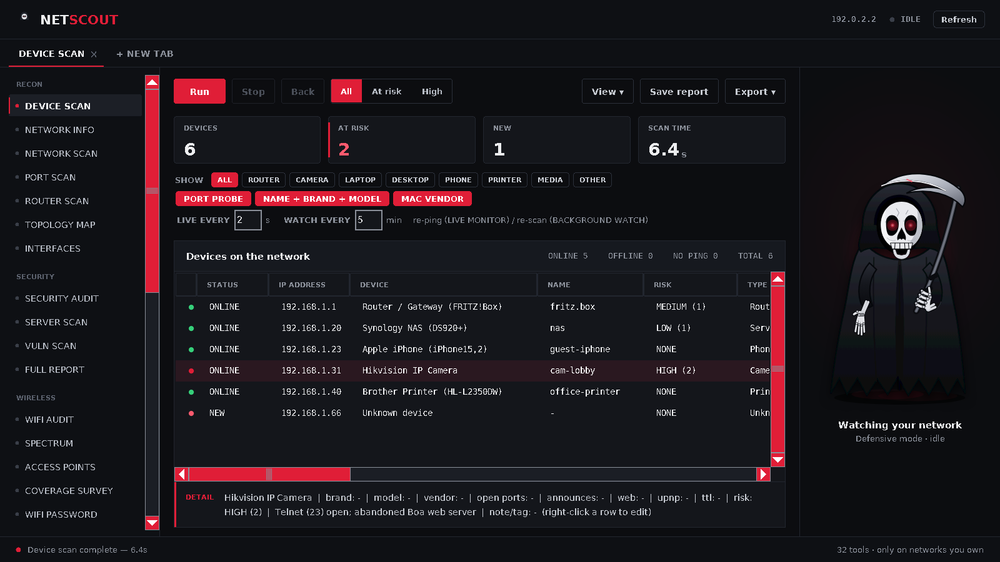
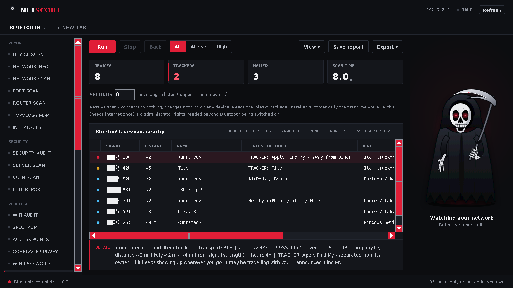
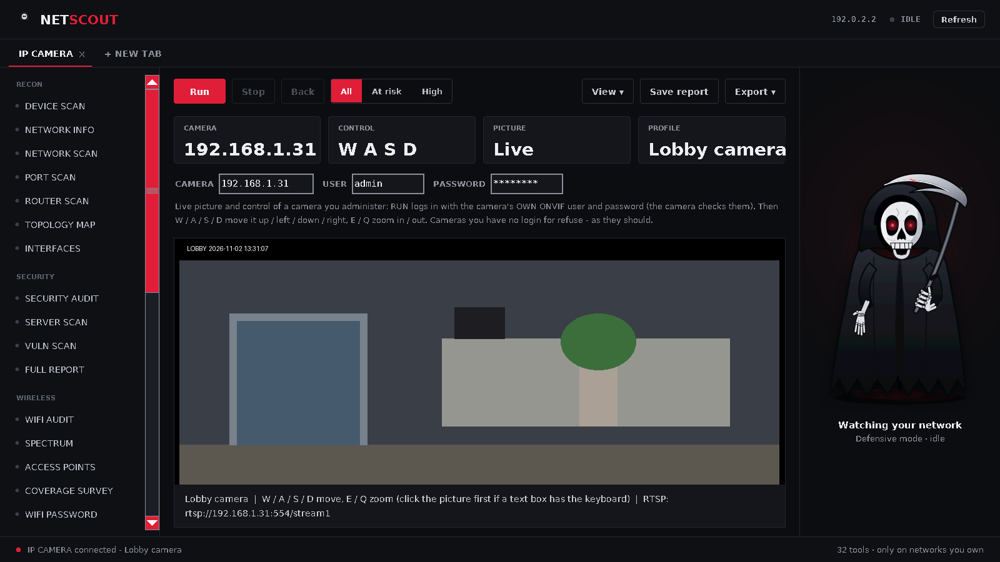

<p align="center">
  
</p>

<h1 align="center">NetScout</h1>

<p align="center"><strong>A cross-platform network scanner and defensive security toolkit — in a single window, with no Python required to run it.</strong></p>

<p align="center">
  
  
  
  
  
  
</p>

<p align="center">
  
</p>

NetScout shows you every device on your network, what each one is, and whether anything looks wrong — then gives you the tools to look closer and keep it safe. It runs on **Windows, macOS and Linux**, is written in **pure Python standard library** (no third-party runtime dependencies), and ships as a **standalone app** that needs nothing installed on the machines you run it on.

> **Scope:** NetScout is a *defensive* tool for networks **you own or are authorised to administer** — your home, your company, your lab. It only ever acts through equipment you control, and it will not perform attacker techniques (see *Philosophy* below). Don't point it at networks that aren't yours.

---

## Highlights

- **32 tools** in one interface — device discovery, WiFi/Bluetooth, monitoring, a one-click security audit, deep **server** and **vulnerability** scans, a one-click **branded security report**, a passive packet inspector, and everyday network utilities (subnet calculator, DNS toolkit, website health).
- **Pure standard library.** No `pip install` needed to run from source; Bluetooth is the only optional extra.
- **Truly standalone builds.** The packaged app bundles its own Python and Tcl/Tk — target machines need nothing installed. The build scripts *prove* it before they finish.
- **Cross-platform**, with per-OS backends that degrade gracefully when a feature isn't available on a given machine.
- **1,000+ automated checks** across 46 test files covering the engine and the GUI.
- **Honest by design.** Where a result is an estimate or a guess, it says so; where something can't be done safely, it explains why instead of faking it.

---

## Screenshots

| Bluetooth & item-tracker detection | IP camera (ONVIF) control |
|---|---|
|  |  |

---

## What it does

### Discovery & inventory
- **Device Scan** — every device on the network, with best-effort identification of type, brand and model (MAC vendor, hostnames, mDNS/Bonjour, **WS-Discovery**, UPnP, SNMP, open ports, TTL). Finds devices that ignore ping — phones with randomised MAC addresses, and the cameras, printers and Windows PCs that only answer WS-Discovery — and **drops devices that have left** instead of listing stale ARP-cache entries (it checks the OS's own neighbour re-probe on Linux and Windows).
- **Network Info** — your IP, subnet, gateway, DHCP and DNS at a glance, plus **Internet Check** (reachability, latency, DNS tampering detection) and a **Speed Test**.
- **Topology Map** — a picture of the network with the router at the centre.
- **Interfaces**, **Ping** (with **Trace Route**), **Router Scan** (including a **UPnP port-forward audit**).

### WiFi
- **Network Scan** — every WiFi network in range, sortable/filterable by band. On Windows each pass triggers a **fresh scan** through the WLAN API (no admin rights), instead of re-reading Windows' cached list.
- **Access Points** — physical access points nearest-first, with a "warmer/colder" locator to walk to one.
- **WiFi Audit** — open networks, weak encryption, possible evil twins, rogue hotspots, A–F security grades.
- **Spectrum** — per-channel interference map and the best channel for your own network.
- **Coverage Survey** — walk room to room and build a signal heatmap to find dead spots.
- **WiFi Password** (for the network you're on).

### Bluetooth
- **Bluetooth** — passive BLE (and, on Linux, classic) discovery with median-smoothed signal and a calibrated distance range. Decodes what devices announce: Apple Continuity (AirPods, Watch, Handoff, Hotspot…), iBeacon and Eddystone beacons (including the URL), makers from Bluetooth company IDs.
- **Item-tracker detection** — AirTags / Find My items (and whether one is *separated from its owner*), Tile, Samsung SmartTag, Chipolo and Google Find My Device tags are flagged and listed first.

### Monitoring
- **Live Monitor** — continuous latency/packet-loss view.
- **Background Watch** — rescans on an interval and alerts the moment an unknown device joins.
- **Threat Monitor** — watches for attacks in progress: deauthentication floods, evil twins, security downgrades, a vanishing network, beacon floods, and ARP-spoofing / man-in-the-middle.
- **Packet Inspector** — a passive, tcpdump/Wireshark-style look at live traffic on a link you administer: a packet-by-packet list plus an analysis of the protocol mix, who is talking to whom, the busiest ports, and **plaintext protocols** worth securing. It only *listens* (never transmits), keeps packet **headers and metadata only** — never message contents — and is admin-gated (Linux `AF_PACKET`; Windows `SIO_RCVALL`; on macOS it points you at `sudo tcpdump`).
- Optional **desktop notifications** so alerts are seen when the window is minimised.

### Security & control (for infrastructure you administer)
- **Security Audit** — one read-only pass that reuses the device scan, WiFi scan and router/firewall checks, then scores the network **A–F** and lists every issue **worst-first with a concrete fix** (open admin ports, open/weak WiFi, WPS, missing PMF, known-vulnerable software, router/ARP integrity, this machine's firewall). It only reads what a scan can see — it changes nothing, and it's a posture check, not a penetration test.
- **Server Scan** — point it at the servers on your LAN and get a full per-server audit: a confirmed scan across ~100 service ports, service/version detection, known-vulnerability flags, exposed-datastore and risky-service detection, and TLS-certificate checks — each server graded **A–F** with a fix for every issue. Reads only; never exploits anything.
- **Vulnerability Scan** — the same deep audit aimed at *every* device, flattened into one **worst-first list** of everything known-vulnerable or dangerously exposed (outdated/EOL software, unauthenticated databases, expired/self-signed certificates, risky open services). Version- and exposure-based ("update, or confirm it's patched") — not an exploit scanner.
- **Full Report** — one click runs the audit + server scan + vulnerability scan and produces a single **branded, self-contained HTML report** (NetScout reaper + wordmark, overall **A–F** grade, executive summary, every finding with a fix). Opens in any browser and **prints cleanly to PDF** to email or attach to a ticket. All scanned text is HTML-escaped, so a hostile banner can't tamper with the page.
- **Port Scan** — open ports with service/version detection and **outdated / known-vulnerable software** warnings, plus TLS certificate checks.
- **Firewall** — shows your real attack surface and whether the OS firewall is guarding it.
- **MAC Privacy** — a randomised hardware address, the way phones do it.
- **Switch Port / Cable Test / DHCP Check** — SNMP tools for managed switches (identify a port, find a failing cable, catch a rogue DHCP server).
- **Power Control** — Wake-on-LAN, a usage check, and **credentialed** shutdown/restart over Windows admin, **WinRM**, SSH+sudo, or a server's **IPMI/BMC** (the target authenticates; the BMC password is passed via the environment, never the command line or stored), including **bulk shutdown of idle machines**. There is no uncredentialed / forced power-off, by design.
- **IP Camera** — live picture and pan/tilt/zoom (W/A/S/D, E/Q) for ONVIF cameras you administer, using the camera's own login (WS-Security digest; the camera authenticates every frame and move). No access to cameras you have no login for.
- **Attack response** — cut an offending host off without powering anything off: **block it at this machine's own OS firewall** (Windows/Linux, reversible, needs local admin) or, with a managed switch, **disable its switch port** (SNMP, reversible). The ARP-spoofing check names the specific host impersonating the router.

### Network toolkit
- **Subnet Calculator** — IPv4/IPv6 subnet maths: network, broadcast, usable host range and count, netmask and wildcard — from a CIDR, an IP + mask, or a bare address — plus splitting a block into equal subnets. Pure, no traffic.
- **DNS Toolkit** — forward and reverse lookups and the common record types (A, AAAA, MX, TXT, NS, CNAME, SOA, PTR) against the system resolver or one you name, with the response time and status.
- **Website Health** — fetch a site (following redirects), report status and response time, inspect the TLS certificate and its expiry, and check the common security response-headers (HSTS, CSP, X-Frame-Options…) — graded **A–F**.

### Reporting
- Save results as **TXT / CSV / JSON**, or a self-contained **HTML report** to share with a colleague.

---

## Install & run

### Option A — the standalone app (recommended)
Grab the build for your OS (or build it yourself, below) and run it. **No Python needed.**

- **Windows:** run `NetScout.exe`. If SmartScreen warns about an unknown app, choose *More info → Run anyway*. On locked-down PCs, use the `NetScout-Folder` version.
- **macOS:** right-click `NetScout.app` → *Open* the first time.
- **Linux:** run the `NetScout` binary (a `.desktop` entry is installed too).

### Option B — from source
Requires Python 3.9+ (3.11–3.13 recommended). No third-party packages are needed to run.

```bash
python3 netscout_gui.py       # the graphical app
python3 netscout.py --help    # the command-line interface
```

Bluetooth scanning is optional and uses [`bleak`](https://pypi.org/project/bleak/):

```bash
pip install bleak
```

---

## Building a standalone app

NetScout is packaged with [PyInstaller](https://pyinstaller.org/). PyInstaller can't cross-compile, so build **once on each OS** you want a copy for:

```
Windows:   build_windows.bat
macOS:     bash build_macos.sh
Linux:     bash build_linux.sh
```

Each script finds a suitable Python, bundles Tcl/Tk, builds the app, and then **starts it with Python hidden from it** to verify it really is standalone before finishing. Full details — including why a build can "still need Python on some PCs" and how that's prevented — are in **BUILD_README** / the Build Guide PDF.

> Build with a standard **python.org** Python (not the Microsoft Store build, not a "free-threaded" `3.13t` build). The Windows script will refuse the Store build and tell you why.

---

## A quick first run

1. Open NetScout and click **Device Scan → Run**. In a few seconds you'll see everything on your network.
2. Turn on **Background Watch** to get alerted when something new joins.
3. **Right-click** any device for notes, approval, or power actions.
4. Explore — everything that only *reads* is completely safe; anything that *changes* something asks first.

A full beginner's guide is included as **USER_MANUAL** / the User Manual PDF.

---

## Philosophy — why it's defensive-only

NetScout is deliberately built so it can't be turned into an attack tool, because that's what makes it safe to hand to everyone on a team:

- It **reads** by default. The few actions that change something (firewall, MAC, disconnect, power) warn first and act only through infrastructure you administer.
- Even the capture tool is **passive and metadata-only**: the Packet Inspector opens a receive-only socket, never transmits, and keeps packet headers and summaries — not the contents of anyone's messages. There is no stream reassembly, no credential scraping, and no payload capture.
- Every powerful action is **gated on credentials the target itself checks** — SNMP write community for a switch port, admin rights or SSH for a shutdown. NetScout never forces a device that hasn't accepted the command.
- It **won't** do attacker techniques: no deauthentication/jamming, no ARP/IP spoofing, no evil-twin creation, no credential or handshake cracking, no forcing devices it has no rights over.
- It doesn't pretend. "Make me untraceable" isn't a real thing, so it offers MAC randomisation and points to a VPN/Tor instead of faking it.

---

## Limitations (the honest list)

- **Vulnerability warnings are version-based.** A vendor that back-ports a fix without changing the version string will still be flagged — the wording is always "update, *or confirm it's patched*".
- **Device identification is best-effort.** "Computer" means "a PC/laptop but can't tell which".
- **Some tools need the right environment.** SNMP tools need a managed switch; true deauth-frame detection needs monitor mode (NetScout uses the OS's own disconnect log instead, which works everywhere but is indirect); spectrum analysis sees only WiFi, not microwaves or other RF.
- **Distances are estimates** from signal strength — a radius, not a GPS fix.
- **Speed Test / Internet Check** may be blocked on some corporate networks.

---

## Project layout

| File | What it is |
|---|---|
| `netscout.py` | The engine — all the network logic and the CLI. |
| `netscout_gui.py` | The graphical app (generated; Tkinter). |
| `netscout.spec` | PyInstaller build recipe (same file for all three OSes). |
| `build_windows.bat` / `build_macos.sh` / `build_linux.sh` | Per-OS build scripts. |
| `USER_MANUAL` | Beginner's guide. |
| `BUILD_README` | How to build the standalone app. |

---

## License

Released under the **MIT License** — see `LICENSE`. In short: free to use, modify and distribute, with no warranty.

---

## Disclaimer

NetScout is provided for legitimate network administration and defensive security on networks you own or are explicitly authorised to manage. **You are responsible for how you use it.** Scanning or interacting with networks and devices without authorisation may be illegal in your jurisdiction. The authors accept no liability for misuse or for any damage arising from its use.
